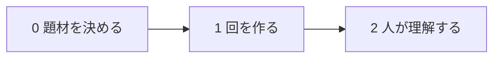

# 書き方の決まり

決まりごとに、決まりの文・理由・例・出どころを書く。出どころは、ユーザーがいつ何と言ったか。

足すときは `SKILL.md` の `learn` の手順に従う。

## 1. 図は draw.io か Mermaid で書く

文字を並べて作った図は使わない。

| 道具 | 使う場面 |
|---|---|
| draw.io | 複雑な図。ユーザーが後で編集したい図 |
| Mermaid | 簡単な図。ユーザーが特に編集しない図 |

どちらか迷ったら、ユーザーに聞く。

作り方：

- Mermaid：Markdown の中に ` ```mermaid ` のコードブロックで書く
- draw.io：文書と同じフォルダーに `<名前>.drawio` を置き、文書からリンクする。中身は圧縮しない XML で書く

出どころ：2026-11-17、ユーザー「図を書くときには、drawio や mermaid で記載すること」

悪い例：

````
```
0 題材を決める ──▶ 1 回を作る ──▶ 2 人が理解する
```
````

良い例：

````

````

## 2. 英語を直訳した日本語を使わない

普段カタカナで言う言葉は、漢字の言葉に訳さず、カタカナのまま書く。

パターンと代表例は `terms.md` にある。代表例は少数しか載せないので、例にない言葉もパターンから判断して言い換える。

出どころ：2026-11-17、ユーザー「英語を直訳した日本語がある。例えば、版がバージョンになってほしい」

| 悪い例 | 良い例 |
|---|---|
| 直しは版を上げる | 直すたびにバージョンを上げる |

## 3. 補足をカッコ書きで入れない

カッコ書きの補足は、文の流れを切るので読みにくい。補足は次のどれかにする。

- 独立した文にする
- 表の列にする
- 箇条書きの子の項目にする
- 読む人に要らない補足なら、消す

`rewrite` では内容を削らないので、「消す」は使わず、消してよいかを報告で聞く。

出どころ：2026-11-17、ユーザー「カッコ書きで補足しているところは人間には見にくい」

悪い例：

```
回は「資料・実装・計測・素材」まで作って区切る（決定 0012 の 1 章）。
```

良い例：

```
回は「資料・実装・計測・素材」まで作って区切る。根拠は決定 0012 の 1 章。
```

## まだ一般化していない直し

決まりにするか判断がつかなかった直しを、そのまま書き留める。似たものが 2 件以上たまったら、決まりにする案を出す。

- 2026-11-17：トピックの「コンテンツ制作の流れ」の文書（`topics/robot-company-game/series/FLOW.md`）の冒頭に「2026-11-17 に作成。1 本目の失敗を受けて…」と作成の経緯を書いていたら、ユーザー「こういう経緯はいらないはずです」。その文書では経緯を消した。**「人が読む文書には経緯を書かない」と一般化するのは飛躍**（ユーザー 2026-11-17）。どの種類の文書で経緯が要らないのかは、この 1 件では決められない。似た直しが出たら、文書の種類と経緯の中身を比べて考える
